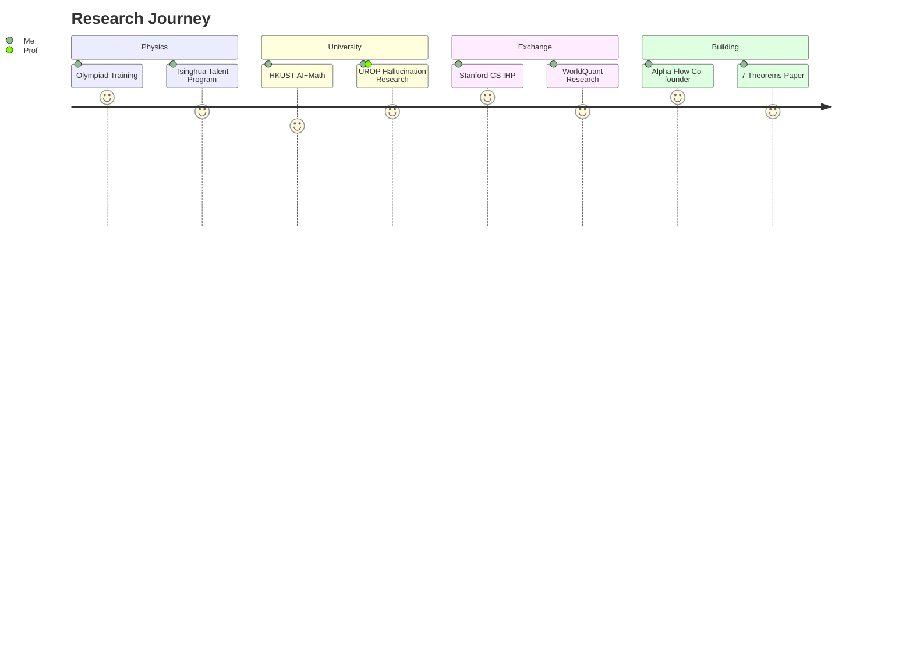

<div align="center">

<h1>HongJin HE &nbsp;何泓锦</h1>

[](https://git.io/typing-svg)

<p>HKUST RMBI+MATH+AI '29 &nbsp;·&nbsp; Stanford IHP '26</p>

<p>
<a href="mailto:hehongjinhkust0911@gmail.com"></a>
<a href="https://www.linkedin.com/in/hongjinhe-hkust-edu"></a>
<a href="https://github.com/hongjin-he/mathmatical-framework-for-world-models-in-quant-finance"></a>
</p>

</div>

---

> *Factor models learn correlations. World models learn causation. The difference is everything.*

I came to machine learning from mathematical physics — with the conviction that the right mathematical structure, once found, makes everything else obvious.

My work sits at the intersection of **rigorous theory** and **empirical systems**: I prove theorems and ship code. Sometimes on the same day. Usually not.

---

## How I Got Here



---

## Research Areas

<table>
<tr>
<td align="center" width="160"><b>🧠 Deep Learning</b><br/><sub>GFlowNets · Transformers<br/>Flow Matching · VAE</sub></td>
<td align="center" width="160"><b>🎮 Reinforcement Learning</b><br/><sub>Model-based RL · PPO/DDPG<br/>HJB equations · MDP</sub></td>
<td align="center" width="160"><b>🌍 World Models</b><br/><sub>Market dynamics · E-Game-C<br/>Latent state prediction</sub></td>
</tr>
<tr>
<td align="center" width="160"><b>📈 Quantitative Finance</b><br/><sub>Alpha mining · LOB<br/>Backtesting · IC/ICIR</sub></td>
<td align="center" width="160"><b>∑ Mathematical Finance</b><br/><sub>SDEs · Lévy processes<br/>Mean-field games · Groupoids</sub></td>
<td align="center" width="160"><b>⛓ Blockchain</b><br/><sub>DeFi mechanisms · On-chain<br/>data · Smart contracts</sub></td>
</tr>
</table>

---

## Projects

### 🌍 [Mathematical Framework for World Models in Quant Finance](https://github.com/hongjin-he/mathmatical-framework-for-world-models-in-quant-finance)
*Preprint · arXiv:q-fin.MF · July 2026 · HKUST + Stanford*

The first systematic mathematical theory connecting world models to quantitative finance. Seven original theorems — no hand-waving.

```
E-Game-C:  x_t → Encoder (VAE) → z_t → Game Module (MFG) → z_{t+1} → Controller π* → a_t
                                              ↑
                              replaces the RNN in Ha & Schmidhuber (2018)
                              with a mean-field game equilibrium operator
```

Key result (Theorem 3): prediction error has a fundamental lower bound of `σ²_τ·h + λ_η·m²_η·h` — irreducible regardless of model complexity. Know your enemy.

---

### 🧠 [GFlowNet Alpha Mining](https://github.com/hongjin-he/GFlowNet-Alpha-Mining)
*Independent research · PyTorch · WorldQuant BRAIN*

GFlowNets don't find the best alpha. They find a *distribution* of good alphas — which is exactly what you need when the goal is a low-correlation portfolio, not a single factor.

```
Mean IC = 0.148   vs   random baseline ≈ 0.05   →   3× improvement
Training time: < 5 min on Google Colab T4
```

Honest caveat: no train/test split yet. Real-world IC is probably lower. The mechanism works; productionizing it is the next step.

---

### 📊 [LLM Hallucination in Financial Disclosures](https://github.com/hongjin-he/LLM-Hallucination-FinanceNLP) *(private — under review)*
*UROP · HKUST Business School · Prof. Tony Cho · Target: Journal of Accounting Research*

5,552 U.S. firms. 50GB+ SEC filings. The finding that keeps me up at night: all tested models (GPT-3.5 through GPT-5) fabricate confident, plausible-sounding answers when the filing contains no relevant information whatsoever.

We called it **D-type hallucination**: the model doesn't know what it doesn't know.

```
Scale:    5,552 firms · SEC 10-K/10-Q · HKUST HPC4
Result:   GPT-4o: +21.5% consistency (BERTScore), +54.8% (Prompt Score) vs GPT-3.5
          D-type: 100% fabrication rate across all models when no ground truth exists
```

---

### 📈 [Stanford AI Labs Ecosystem](https://github.com/hongjin-he/stanford-ai-labs-ecosystem)
*Data visualization · Built before and during Stanford exchange*

Nine interactive visualizations mapping Stanford's 7 AI labs — research trends, collaboration networks, and industry talent flows from 2018 to 2026. Built as a research planning tool, not just a visualization exercise.

---

### 🏗 [Quant Realtime Backtest Framework](https://github.com/hongjin-he/quant-realtime-backtest-framework)
*Educational · Archived*

An ambitious attempt to build a global stock trading platform in one semester. Failed due to data costs, infrastructure complexity, and the general hubris of thinking this was a weekend project. The post-mortem is honest and worth reading if you're considering the same mistake.

---

## Stack

```python
theory   = ["Stochastic Calculus", "Itô/Lévy Processes", "Mean-Field Games",
            "Convex Optimization", "Probability Theory", "Groupoid Algebra"]

ml       = ["GFlowNets", "PPO/DDPG", "Transformers", "Flow Matching", "VAE"]

quant    = ["Alpha Factor Design", "IC/ICIR", "Backtesting", "Order Book Dynamics"]

systems  = ["PyTorch", "Python", "HPC/Slurm", "WRDS/SEC Analytics",
            "OpenAI API", "edgartools", "Git"]
```

---

## Background

Physics Olympiad → Tsinghua Physics Talent Program (rank 92nd nationwide, gold-medal equivalent) → HKUST AI+Math+Risk Management → Stanford CS Exchange

The physics training instilled one habit above all: ask *why does this equation have this form?* before asking *how do I fit it?* In markets, that question leads to stochastic dynamical systems — not factor regressions.

---

<div align="center">


<br/>


<br/><br/>

<sub>
Mathematical Physics → Deep RL → Market Dynamics · HKUST × Stanford · 2026
</sub>

</div>

